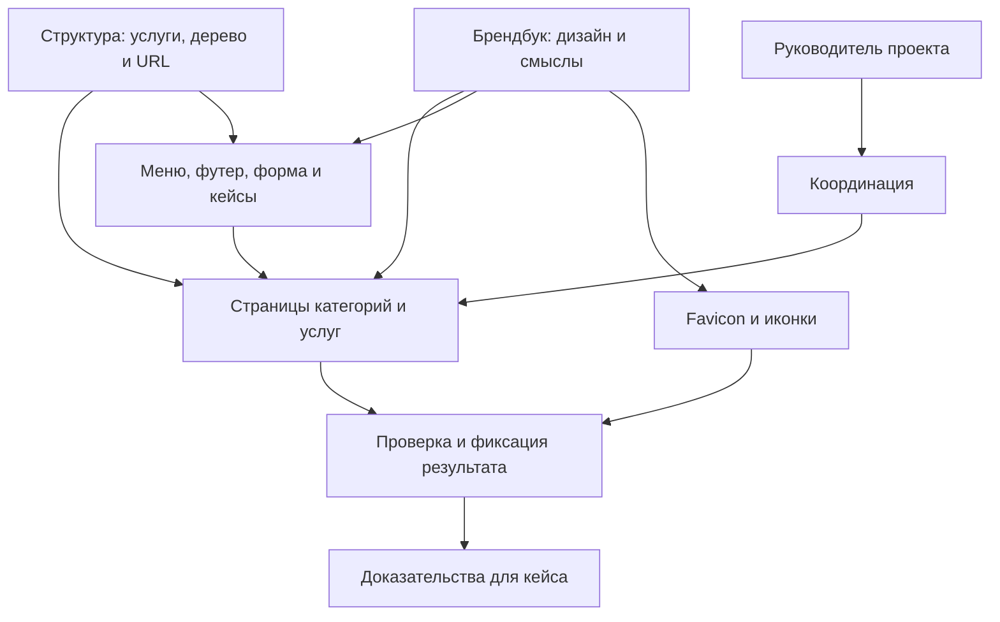

# Разработка сайта с ИИ агентами

Рабочий кейс АЙТАТ: как организовать разработку сайта инженерных услуг через специализированные чаты, общую базу правил и повторно используемые блоки.

**Автор и руководитель процесса: Игорь Васильев.**

**Статус на 16 ноября 2026 года:** существующие чаты и материалы сведены в рабочую схему. Сквозной пилот и измерение эффекта предстоят. Автоматический обмен заданиями между чатами не настроен.

## Задача

У сайта много услуг, категорий и повторяющихся элементов. В ходе разработки нужно сохранять единый дизайн, структуру адресов и согласованные решения. Для этого работа разделена по областям ответственности: бренд, архитектура сайта, общие блоки и отдельные страницы.

## Как устроена работа

Здесь «агент» — роль ИИ в специализированном чате с определёнными входными материалами и результатом. Человек ставит задачи, принимает решения и управляет применением изменений. Само разделение чатов не создаёт автономную команду.

| Роль | Ответственность | Результат |
| --- | --- | --- |
| Координация | Задачи, зависимости, статусы | План работ и журнал результатов |
| Брендбук | Дизайн, смыслы, коммуникация | Общие правила оформления |
| Структура | Линейка услуг, категории, дерево, URL | Единая карта сайта |
| Сквозные блоки | Меню, футер, форма, кейсы | Согласованные версии блоков |
| Иконки | Favicon и варианты иконок | Комплект для установки |
| Категории | Обзор направления и навигация | Страница категории |
| Услуги | Содержание и реализация услуги | Страница услуги |

## Что уже есть

- Брендбук редакции 0.4 и краткая памятка для работы.
- Целевая карта сайта из 47 строк: это проектная структура, а не 47 опубликованных страниц.
- Отдельные чаты брендбука, меню, футера, иконок, каталога, категорий, СКУД, видеонаблюдения и шаблона страниц кейсов.
- Общие файлы контекста и правила обращения к истории других чатов.
- Подготовленный порядок работы и шаблон передачи результата.

## Что даёт такая структура

| Ожидаемая польза | Механизм | Как измерить |
| --- | --- | --- |
| Единый дизайн | Все страницы опираются на один брендбук | Отклонения при первой проверке |
| Меньше повторных объяснений | Принятые решения записываются в общую базу | Повторы уже зафиксированных правил |
| Повторное использование | Страницы используют согласованные блоки | Число повторно использованных блоков и время установки |
| Управляемые изменения | Для каждого блока учитываются потребители | Доля обновлённых зависимых страниц |
| Удобное продолжение работы | У задачи есть источники и карточка результата | Время до первого результата, число уточнений |

Это проверяемые гипотезы. Количественная экономия времени, денег и рост конверсии пока не установлены.

## Рабочий цикл

1. Определить страницу или блок, цель и границы задачи.
2. Прочитать актуальные брендбук, карту сайта и стандарты общих блоков.
3. Зафиксировать недостающие материалы и зависимости.
4. Подготовить результат в рамках своей роли.
5. Проверить содержание, ссылки, адаптивность и взаимодействия.
6. Сохранить версию и заполнить карточку передачи.
7. Отметить, на каких страницах применено изменение общего блока.
8. Записать факты и измерения для кейса.

Общий файл доступен разным чатам, но новые сообщения не передаются автоматически. Обновление исходника блока также не обновляет его ранее установленные копии в Тильде: каждое место установки нужно учитывать.

## Ближайший пилот

Кандидат — страница видеонаблюдения. Начальный этап — текстовый прототип по общей карте и брендбуку с обозначением мест общих блоков. Перед продолжением необходимо сверить текущие решения в её рабочем чате.

Пилот должен показать всю цепочку: задача → общие источники → страница → проверка → передача. Следом нужно проследить одно изменение общего блока на страницах-потребителях.

## Материалы

- [Правила взаимодействия ролей](workflow.md)
- [Шаблон задания и передачи результата](task-template.md)
- [Измерение эффекта](measurement.md)

Публичная версия описывает организацию работы. Внутренние переписки, идентификаторы чатов, локальные адреса файлов и полный брендбук в неё не включены.
